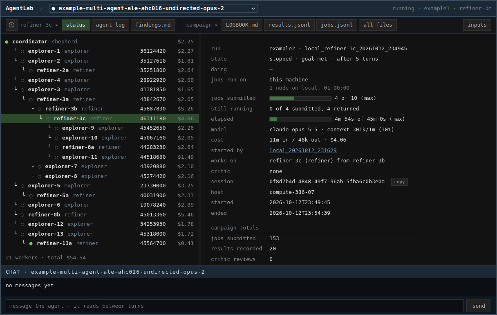
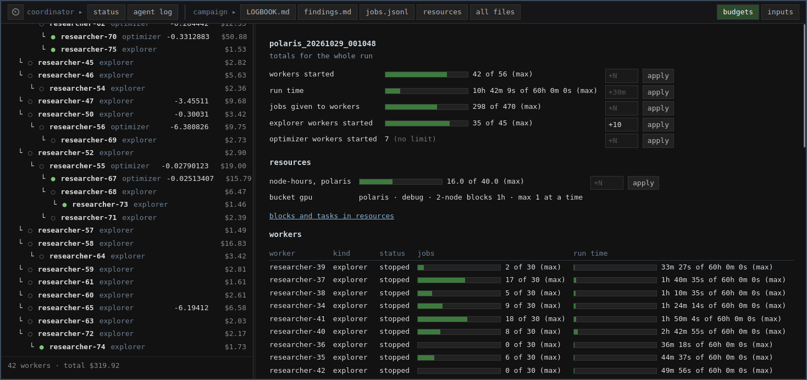
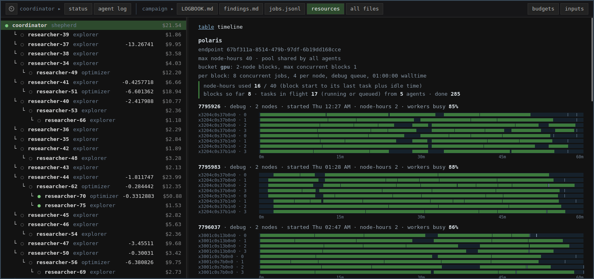

<!-- If you are an agent, read AGENTS.md: it is how to set someone up here. -->

# AgentLab

*A research lab run by agents.*

**[Presentation →](https://github.com/shuds13/agentlab_slides/blob/main/agentlab.pdf)** &nbsp;|&nbsp; **[Tutorial →](https://github.com/shuds13/agentlab_slides/blob/main/agentlab_tutorial.pdf)**

A lab for autonomous agentic workflows that submit work to HPC systems.

A user or team can run any number of investigations side by side, and coordinate many
agents on a single campaign, all visible and steerable from one UI or Slack channel.

You give an agent a goal and a system. It submits the work, reads what comes back,
decides what to try next, and keeps going until it has an answer.

Each investigation is a **campaign**. Campaigns are independent and can run at the same
time, sharing the framework, the system definitions, and optionally one Slack app and
secretary.

Examples:

- **Basic:** [`campaigns/example-quick-optimum/`](campaigns/example-quick-optimum/) — one
  agent finds the lowest point of a noisy response, in minutes, on the local machine.
  `run_remote.sh` runs the same campaign with its jobs on a remote system through Globus
  Compute. `compare.sh` runs it on several models at once, as a group.
- **Multi-agent:** [`campaigns/example-multi-agent-ale-ahc016/`](campaigns/example-multi-agent-ale-ahc016/)
  — a coordinator launches explorer and refiner agents on an AtCoder heuristic contest
  problem, each on its own git branch, on the local machine.
- **GPU:** [`campaigns/example-wind-tunnel/`](campaigns/example-wind-tunnel/) — an agent
  looks for the lowest-drag shape in a wind tunnel simulated on Polaris GPUs, and each
  job returns a picture of the airflow. `run_resources.sh` adds a resource agent that
  picks the queue from what the IRI API reports.



*A multi-agent example mid-run: a coordinator and 21 workers. The selected refiner-3c holds the best score so far; refiner-13a, at the bottom, is still running.*

## Structure

Your directories:

```
users/<you>/   your endpoint UUID, account, and working directory, per system.
               Applies to every campaign you run there. Not tracked by git.

campaigns/<name>/
               prompt.md        the goal
               user_prompt.md   this run's kick-off
               task.py          what a job does
               campaign.json    which system, and what to run on it
               method.md        how the agent works, copied from methods/

workspace/<name>/   or   workspace/<group>/<name>/
               everything the agent produces. Not tracked by git.
```

The lab's:

```
lab.yaml       what this lab runs, and where its own things are. Copied from
               lab.yaml.template. Not tracked by git.

bin/           the commands people type. bin/lab.sh start | stop | status runs
               the lab's long-lived processes.

litellm/       config.yaml — non-Anthropic models this lab can reach, through
               a LiteLLM proxy. Not tracked by git.

framework/     the agent loop and the tools it calls. Not edited per campaign.

methods/       how the agent goes about the work, and what it records — such as
               quick.md, standard.md, or research.md for hypothesis cycles with
               a written-up journal. Setup copies one into your campaign as
               method.md, which is yours to edit or replace.

systems/       one file per machine: module line, proxy, cache paths, queue
               defaults — whatever is true for everyone there.
               endpoints/ — Globus Compute endpoint templates.
```

## Getting started

Clone this repository, start your agent in it, and say:

> Help me set up.

It asks which of two you want.

**Set up the lab and run the example** — the one to take if you are new. It runs on your
local machine. It checks the install, gives you the command for the example campaign, and
reads the results back with you.

**Set up a campaign of your own** — it asks what you are trying to find out, which
machine you will run on, and what files you already have. From that it creates
`campaigns/<your-name>/`, writes the files a campaign needs, records your access in
`users/<you>/`, and walks you through the Globus Compute endpoint.

The agent uses whichever LLM your Claude Code settings point at. [docs/llm.md](docs/llm.md) covers
running against a facility gateway, or against a non-Claude model through LiteLLM.

See [docs/setup.md](docs/setup.md) for more info.

## Running

Each campaign has its own `run.sh` holding its settings. Edit it, then from the campaign
directory:

```
cd campaigns/<name> && ./run.sh
```

Start it inside tmux. A campaign runs for hours or days, and closing the terminal kills
it with jobs in flight.

```
bin/list_agents.sh --all          every run and its outcome
bin/kill_agent.sh --drain <run>   stop cleanly, finishing jobs in flight
bin/talk.sh <run dir>             talk with the agent of a run that has ended
bin/lab.sh status                 the lab's own processes, and their logs
```

## Watching

A browser view of the lab: every campaign, which are running, and the files each one is
writing.

On the machine the lab is on:

```
bin/watch.sh                      the lab
bin/watch.sh <campaign>           open on one campaign
```

From your own computer, when the lab is on a machine you reach by ssh: copy
`bin/watch_remote.sh` to your computer (it needs nothing else from the repository), set
`HOST`, `REPO` and `ACTIVATE` at the top of it, and run:

```
./watch_remote.sh
```

It logs in once, starts the watcher over there, forwards the port it took, and opens
your browser. Ctrl-C stops both ends.

The chat at the bottom of a campaign's page talks to its agents. A message to everyone
goes on the campaign's board (`ANNOUNCEMENTS.md`), which every running agent reads
between turns. With an agent chosen in the agents panel, a message can go to that agent
only: it lands in its run's `INBOX.md`, wakes it if it is waiting, and the other agents
do not see it. Replies come back in the chat under the agent's name. A message to an
agent whose run has ended reopens its saved session, as `bin/talk.sh` does.

## Sandbox

On Linux, `SANDBOX=bwrap` runs the agent in a box built with bubblewrap. It sees only the
files the run needs (its workspace, the campaign, the framework and the system's own
directories) and only the processes it started. A campaign names any other paths its
agent needs in `campaign.json`. See [docs/campaigns.md](docs/campaigns.md#sandbox).

```
SANDBOX=bwrap ./run.sh
```

## Workspaces and groups

A run writes to `workspace/<campaign>/` unless its `run.sh` sets `WORKSPACE_DIR`, so one
campaign directory can feed many workspaces. A workspace one level down,
`workspace/<group>/<name>/`, belongs to a group, and the watch shows the group's runs
together, each with its model, score and cost.

A group can keep one campaign's runs in order (trials, variants, different settings)
without a campaign directory for each. It also holds runs started side by side to be
compared: the quick-optimum example's `compare.sh` runs one workspace per model, Opus,
Sonnet and Haiku unless `MODELS` names others.

```
cd campaigns/example-quick-optimum && ./compare.sh
```

Compute resources can be shared by a running campaign group. Runs that use the same
resource bucket on a system (see [Resources](#resources)) run their jobs in the same
blocks. The Resources tab shows the tasks of all those runs in each block. A resource
session gives the group one node-hour budget for those blocks, from when it is started:
`bin/resource_session.sh <group> start swing=4`. See
[docs/campaigns.md](docs/campaigns.md#resources).

## Budgets

Every limit a run stops at is a budget for the whole run: jobs it may submit, workers it
may start, run time, and node-hours on each system. The framework enforces them: a submit
or a worker beyond its budget is refused, and a run out of time winds down. They can be
raised or cut while the run goes, from the watch's Budgets tab or with `bin/budget.sh`.
The new limit holds at once, and the agent is also told of it at its next turn.

```
bin/budget.sh <campaign>                            the newest run's budgets
bin/budget.sh <campaign> submits=+10 node_hours.polaris=+5
```



*The Budgets tab mid-run, with 10 more explorer workers about to be added.*

## Resources

A campaign's jobs run in buckets: a shape of block on one system (queue, nodes, walltime,
workers per node) shared by all its agents. Blocks are started as tasks arrive, up to a
set number at once, until that system's node-hours are used. Buckets can be added for
several systems. See [docs/campaigns.md](docs/campaigns.md#resources).



*The resources tab as a timeline: 2-node Polaris blocks with 4 workers per node, each task a green bar. A table view lists the same blocks and tasks.*

Setting `max_blocks` above 1 lets a bucket's resources grow and shrink with demand: more
blocks start while tasks are waiting, and a block is released once it has sat idle.

## Writing a campaign

Copy `campaigns/example-vllm-inference-opt/` and replace these files:

| file | what it holds |
|---|---|
| `prompt.md` | the goal, what is fixed, what may vary, when to stop |
| `user_prompt.md` | what to do first |
| `task.py` | how one job runs, what it returns, and what the agent is told about it |
| `campaign.json` | which system, and any parameters for it |
| `method.md` | how the agent goes about the work — copied from `methods/` at setup |

`task.py` defines the job. For work that runs on the system: `JOB_DESC`, `JOB_SCHEMA`,
`job_key`, `remote_fn` — `remote_fn` is sent to the worker by source, so everything it
needs must be imported inside it or passed in through its arguments. A result with
`"refused": true` is a job the task declined to run, and it does not count against
`MAX_SUBMITS`. Files beside the task that `remote_fn` needs on the system (a script it
runs) are named in `REMOTE_FILES` and reach it as `target["files"]`. A result may carry
small files back as `"files": {name: base64}`: they are saved under the workspace's
`outputs/` and the agent is given their paths. For work that runs on the machine the agent is on: `LOCAL_DESC`,
`LOCAL_SCHEMA`, `local_fn`. A task may define both, and the agent is given tools for
whichever it defines. A task with only
`local_fn` needs no Globus Compute endpoint.
